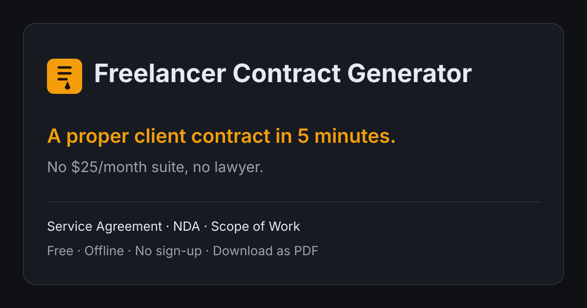
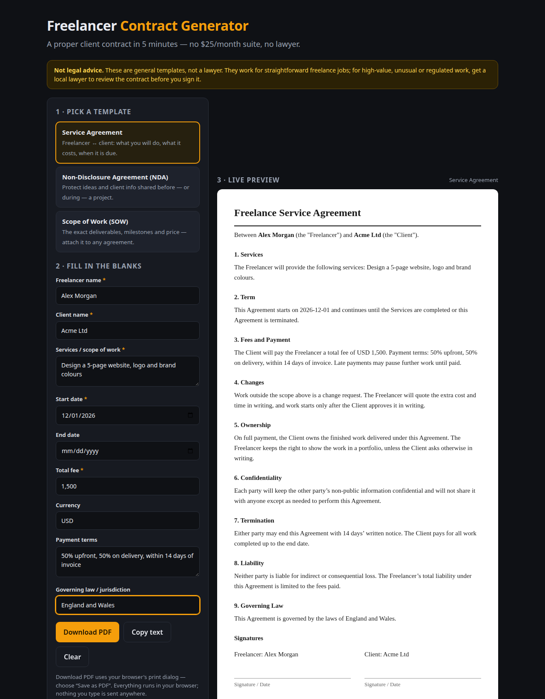
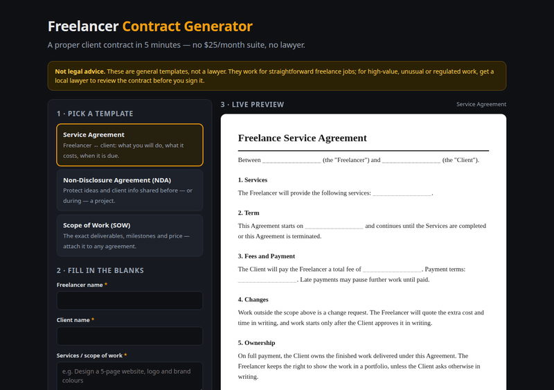

[](https://github.com/mrabr381/freelancer-contract-generator)
[](https://www.buymeacoffee.com/muhammadabubakar)

# Freelancer Contract Generator

**A proper client contract in 5 minutes — no $25/month suite, no lawyer.**

**Live demo: https://mrabr381.github.io/freelancer-contract-generator/**



*The tool in action: a filled-in Service Agreement form (left) and the contract updating live in the preview (right).*



*Typing "Alex Morgan", "Acme Ltd" and a fee of 1,500 into the form — the preview updates as you type, no save or refresh.*

## What it does

Pick a template, fill in the blanks, watch the contract appear live, download it as PDF. That's it.

- **3 templates:** Service Agreement, Non-Disclosure Agreement (NDA), Scope of Work
- **Live preview** — the contract updates as you type
- **Download PDF** — uses your browser's print dialog (Save as PDF); works offline
- **Copy text** — paste the contract into email, Docs, or anywhere else
- **Private by design** — pure HTML/CSS/JS, no server, no sign-up, nothing you type leaves your browser

## How to use

1. Open the [live demo](https://mrabr381.github.io/freelancer-contract-generator/) — or open `index.html` locally.
2. Pick a template (Service Agreement, NDA, or Scope of Work).
3. Fill in the blanks. Fields marked `*` are required.
4. Check the live preview, then click **Download PDF** and choose "Save as PDF" in the print dialog.

## Why this instead of a paid suite?

Bonsai Essentials is $25/month ($19/month billed yearly); its Basic plan ($15) has no contracts or invoices. This tool does contracts only — and costs nothing.

## Honest limits

- Templates are **general-purpose** and cover straightforward freelance jobs only.
- No e-signatures, no storage, no sending — you download the PDF and handle signing yourself.
- No clause customisation beyond the blanks; if your job has unusual terms, add them in writing with the other party.
- Dates and money are entered as plain text, so check them before you send anything.

## Not legal advice

**This is a general template, not legal advice and not a substitute for a lawyer.** For high-value, unusual, or regulated work, get a local lawyer to review the contract before you sign it.

## Run the tests

```bash
node --test tests/contract.test.js
```

No dependencies, no build step. Tests cover template rendering with filled values, required-field validation, blank-value handling, and print/PDF content including the filled values.

## Files

- `index.html` — the tool (open it, it just works)
- `assets/screenshot.png` + `assets/demo.gif` — the screenshot and demo shown in this README
- `contract.js` — template + validation logic (shared by the page and the tests)
- `app.js` — form, live preview, print/copy wiring
- `styles.css` — styling, including the print stylesheet
- `tests/contract.test.js` — Node test suite
- `.github/workflows/ci.yml` — runs the tests on every push
